# Awesome-In-Memory-Data-Stores

<p align="center">
  
</p>

<p align="center">
  <a href="https://github.com/ishandutta2007/Awesome-Awesome-Awesome"></a>
  <a href="https://discord.gg/jc4xtF58Ve"></a>
  <a href="https://github.com/ishandutta2007/Awesome-In-Memory-Data-Stores/stargazers"></a>
  <a href="https://github.com/ishandutta2007/Awesome-In-Memory-Data-Stores/network/members"></a>
  <a href="https://github.com/ishandutta2007/Awesome-In-Memory-Data-Stores/blob/main/LICENSE"></a>
  <a href="https://github.com/ishandutta2007"></a>
</p>

---

## ⚡ Top In-Memory Data Stores & Distributed Caching Ecosystem

> 🚀 **A curated directory of high-performance in-memory databases (IMDB), distributed key-value caches, In-Memory Data Grids (IMDG), and self-hosted low-latency data platforms.**

**Last updated: October 2026**

In-memory data stores keep data resident in RAM rather than relying on persistent disk I/O, delivering microsecond-to-sub-millisecond latency for real-time web applications, high-throughput financial pipelines, distributed session state, real-time feature stores for AI/ML inference, and pub/sub message queuing.

This guide provides an exhaustive, comparative taxonomy across both **commercial SaaS/hosted platforms** and **active open-source GitHub projects**.

---

## 📑 Table of Contents

- [📊 Sector Overview & Market Dynamics](#-sector-overview--market-dynamics)
- [☁️ SaaS & Hosted Platforms](#️-saas--hosted-platforms)
- [🔓 Open-Source GitHub Projects](#-open-source-github-projects)
- [💡 Architectural Comparison & Selection Guide](#-architectural-comparison--selection-guide)
- [🤝 How to Contribute](#-how-to-contribute)
- [💖 Support & Sponsorship](#-support--sponsorship)
- [⭐ Star History](#-star-history)
- [⚖️ Disclaimer & Licensing Nuance](#️-disclaimer--licensing-nuance)

---

## 📊 Sector Overview & Market Dynamics

The global in-memory database and computing market is estimated at approximately **$7.6B to $10B+ in 2024** and projected to reach **$30B to $48B+ by the early 2030s**, compounding at an aggressive **~14%–19% CAGR**.

### Market Concentration & Fragmentation:
* **Moderate Fragmentation Overall with Incumbent Concentration**: The market is anchored at the enterprise tier by cloud hyperscalers and ERP software conglomerates (**Amazon AWS, Microsoft Azure, SAP HANA, Oracle**), which command high enterprise market shares through native cloud VPC integration, existing customer lock-in, and suite bundling.
* **Vibrant Open-Source & Specialist Fragmentation**: Below the hyperscalers, there is intense competition among specialized low-latency platforms (**Redis, Valkey, Dragonfly, Hazelcast, GridGain/Apache Ignite, Aerospike**). Licensing shifts (such as Redis's transition to RSALv2/SSPLv1/AGPLv3) have triggered tectonic shifts, catalyzing community-governed initiatives under the Linux Foundation (Valkey) and hyper-optimized multi-threaded modern engines (Dragonfly, Garnet).

---

## ☁️ SaaS & Hosted Platforms

Managed cloud engines eliminate operational overhead, cluster partitioning friction, high availability management, and WAN backup maintenance. The table below compares the leading hosted in-memory platforms sorted by company scale.

| 🏢 Platform | 📈 Company Scale (Valuation / Revenue) | 💳 Pricing (Starting Tier) | 🎁 Free Tier Limits | ✨ Key Highlights |
| :--- | :--- | :--- | :--- | :--- |
| **[Amazon ElastiCache](https://aws.amazon.com/elasticache/)** | **~$2.3T+ Market Cap** (Amazon) / AWS ~$108B annual revenue (2024) | Starts at **$0.017/hour** (~$12.41/month) for `cache.t3.micro` on-demand (Valkey/Redis/Memcached); Serverless from ~$0.006/GB-hour | **12-Month Free Tier**: 750 hours/month of `cache.t3.micro` or `cache.t2.micro` node usage + 15 GiB data transfer out (for accounts created before July 15, 2025) OR **$100 AWS Free Tier credits** (for newer accounts, applicable to Serverless/instances). | Fully managed Redis, Valkey, and Memcached service natively integrated into AWS VPCs with automatic failover and serverless auto-scaling. |
| **[Redis Enterprise (Redis Cloud)](https://redis.io/cloud/)** | **~$2.0B Valuation** / ~$200M+ ARR | **Essentials plan starts at $5/month** (250 MB storage, 1,000 ops/sec, 256 connections); Dedicated Pro starts at $200/month | **Forever Free Plan**: 1 database, up to **30 MB memory**, 100 ops/sec max throughput, 30 concurrent connections, and 5 GB/month total network bandwidth (no HA/clustering). | Fully managed Redis with Active-Active geo-distribution (CRDTs), 99.999% SLA uptime, Redis Stack data models, and 24/7 enterprise support. |
| **[Hazelcast Cloud](https://cloud.hazelcast.com/)** | **~$100M–$250M Valuation** (~$66.7M total funding) / ~$10M–$50M ARR | **Pay-as-you-go Serverless** starting per GiB-hour consumed (~$0.10/GiB-hour meter); Dedicated clusters via custom commitments | **Free-for-life Sandbox**: Development cluster capped at **0.5 GiB (512 MiB) storage**, 1 single member (no HA/persistence/backups, cluster auto-pauses after inactivity), plus a **14-day fully featured Cloud trial**. | Managed in-memory computing and distributed streaming platform (Jet engine + IMDG) for low-latency compute and near-cache JVM applications. |
| **[GridGain (Nebula)](https://www.gridgain.com/)** | **~$25M–$50M Historical Valuation** (~$33M–$55M total funding; acquired by MariaDB in 2026) / ~$10M–$50M ARR | **Managed Clusters start at $1.98/hour** (Size S: AWS `r5.xlarge`, 4 vCPU, 30.5 GB RAM, 16 GB off-heap, 400 GB SSD); Attached monitoring starts at $0.11/node/hour | **30-Day Free Trial**: Fully functional evaluation license key for GridGain Enterprise/Nebula platform features (no permanent free cloud tier). | Commercial in-memory data grid and database powered by Apache Ignite, featuring ANSI-99 SQL, distributed ACID transactions, and continuous replication. |

---

## 🔓 Open-Source GitHub Projects

Self-hosted in-memory databases and caching layers provide ultimate architectural sovereignty, full control over memory allocation and eviction policies, and eliminate managed-cloud egress margins.

*The projects below are ranked in descending order by GitHub stargazers count:*

1. ### **[Redis](https://github.com/redis/redis)** [](https://github.com/redis/redis/stargazers)
   * **Category**: In-Memory Data Structure Server & Cache
   * **Language / License**: C | RSALv2 / SSPLv1 / AGPLv3 (Redis 8+)
   * **Overview**: The ubiquitous benchmark for in-memory data management. Beyond simple string key-value pairs, Redis provides native data structures including Hashes, Lists, Sets, Sorted Sets, Bitmaps, HyperLogLogs, Geospatial indexes, and Streams. Provides optional persistence (RDB snapshots & AOF logs), Sentinel high-availability, and Redis Cluster automatic partitioning.
   * **Best For**: High-speed caching, shared user sessions, real-time message brokers, gaming leaderboards, and rate-limiting.

2. ### **[etcd](https://github.com/etcd-io/etcd)** [](https://github.com/etcd-io/etcd/stargazers)
   * **Category**: Distributed Consistent Key-Value Store
   * **Language / License**: Go | Apache 2.0
   * **Overview**: A strongly consistent, distributed key-value store that provides a reliable way to store critical data across a distributed cluster of machines. Built on the Raft consensus algorithm, etcd powers Kubernetes service discovery and state coordination. All active working sets are served directly from RAM with sequential write-ahead logging (WAL) and bbolt persistence.
   * **Best For**: Configuration management, cluster state coordination, distributed locking, and service registry.

3. ### **[Dragonfly](https://github.com/dragonflydb/dragonfly)** [](https://github.com/dragonflydb/dragonfly/stargazers)
   * **Category**: Multi-Threaded In-Memory Data Store (Redis & Memcached Drop-in)
   * **Language / License**: C++ | BSL 1.1 / Open-Source Convertible
   * **Overview**: Engineered as a modern replacement for Redis and Memcached, Dragonfly implements a shared-nothing multi-threaded architecture over io_uring. It achieves up to 25x the throughput of legacy single-threaded Redis on multi-core servers, supports gigabyte-scale memory density without Redis fork-memory overhead, and delivers full Redis API compatibility.
   * **Best For**: Extreme throughput caching, high-concurrency workloads, and minimizing memory infrastructure costs on multi-core hardware.

4. ### **[Valkey](https://github.com/valkey-io/valkey)** [](https://github.com/valkey-io/valkey/stargazers)
   * **Category**: Open-Source Distributed Key-Value Datastore (Linux Foundation)
   * **Language / License**: C | BSD-3-Clause
   * **Overview**: Formed under the Linux Foundation with backing from AWS, Google Cloud, Oracle, Ericsson, and Heroku following Redis's relicensing, Valkey is the community-governed, 100% open-source fork of Redis 7.2. It preserves strict BSD-3 licensing, ensures drop-in API and protocol compatibility, and incorporates active multi-threaded performance and clustering enhancements.
   * **Best For**: Enterprise teams and SaaS stacks needing a permanent, OSI-approved open-source drop-in replacement for Redis.

5. ### **[Redisson](https://github.com/redisson/redisson)** [](https://github.com/redisson/redisson/stargazers)
   * **Category**: In-Memory Data Grid & Distributed Java Objects (Redis-backed)
   * **Language / License**: Java | Apache 2.0
   * **Overview**: Redisson provides a distributed, scalable Java data grid framework on top of Redis. It maps familiar Java collections and concurrency primitives (Map, ConcurrentMap, Set, List, Queue, Lock, Semaphore, ReadWriteLock, AtomicLong) into distributed, thread-safe memory constructs across Redis clusters.
   * **Best For**: Java microservices requiring distributed locking, coordination, cluster scheduling, and local Near-Caches.

6. ### **[Memcached](https://github.com/memcached/memcached)** [](https://github.com/memcached/memcached/stargazers)
   * **Category**: Multi-Threaded Key-Value Memory Object Cache
   * **Language / License**: C | Revised BSD
   * **Overview**: The minimalist pioneer of distributed memory caching. Designed with a clean, multi-threaded internal architecture that scales linearly with available CPU cores. Operates strictly as an ephemeral LRU cache without disk persistence, cluster-coordination overhead, or complex data types. Sharding is delegated entirely to the client hashing rings.
   * **Best For**: High-throughput web tier caching, database query offloading, and workloads where pure speed and simplicity eclipse advanced data structures.

7. ### **[KeyDB](https://github.com/Snapchat/KeyDB)** [](https://github.com/Snapchat/KeyDB/stargazers)
   * **Category**: Multi-Threaded High-Performance Database (Redis Alternative)
   * **Language / License**: C++ | BSD-3-Clause
   * **Overview**: Maintained by Snapchat, KeyDB is a high-performance multithreaded alternative to Redis. KeyDB executes queries concurrently across multiple cores, supports active-replication (multi-master), flash storage tiering (FLASH) to spill cold memory to NVMe, and maintains complete wire compatibility with standard Redis protocols.
   * **Best For**: Workloads saturating single-threaded Redis CPU bounds and deployments desiring native Active-Active multi-master replication.

8. ### **[Garnet](https://github.com/microsoft/garnet)** [](https://github.com/microsoft/garnet/stargazers)
   * **Category**: Ultra-Fast Cache-Store (Microsoft Research)
   * **Language / License**: C# / .NET | MIT
   * **Overview**: Developed by Microsoft Research, Garnet is a next-generation remote cache-store designed for unprecedented throughput and microsecond latency. Built on the Tsavorite storage library, Garnet supports the standard Redis serialization protocol (RESP), multi-threading, tiered flash storage, raw memory lock-free execution, and custom C# extension routines.
   * **Best For**: Extreme throughput requirements in cloud environments, multi-tenant caching, and .NET ecosystem backends.

9. ### **[BigCache](https://github.com/allegro/bigcache)** [](https://github.com/allegro/bigcache/stargazers)
   * **Category**: In-Memory Local Cache for Go (GC Overhead-Free)
   * **Language / License**: Go | Apache 2.0
   * **Overview**: A lightning-fast, zero-GC-overhead in-memory cache written in Go designed to hold millions of entries without degrading Go runtime Garbage Collector performance. By bypassing pointer serialization and managing raw off-heap byte buffers with custom sharding, BigCache keeps pause times negligible even under heavy write traffic.
   * **Best For**: High-throughput Go services requiring high-capacity in-process memory caching without GC stop-the-world spikes.

10. ### **[Hazelcast](https://github.com/hazelcast/hazelcast)** [](https://github.com/hazelcast/hazelcast/stargazers)
    * **Category**: Distributed In-Memory Data Grid (IMDG) & Stream Processing
    * **Language / License**: Java | Apache 2.0 / Hazelcast Community License
    * **Overview**: A enterprise-grade distributed computing and storage platform. Hazelcast operates in both embedded JVM and client-server topologies. It partitions data across cluster nodes with built-in backup partitions, offering distributed Maps, Collections, Locks, Near Caches, and the Jet stream-processing engine for executing SQL and stateful event stream pipelines directly against in-memory data.
    * **Best For**: JVM-centric architectures needing compute colocation (entry processors), stateful stream computations, and real-time operational event processing.

11. ### **[FreeCache](https://github.com/coocood/freecache)** [](https://github.com/coocood/freecache/stargazers)
    * **Category**: Zero-GC Embedded Cache for Go
    * **Language / License**: Go | MIT
    * **Overview**: An embedded, highly concurrent memory cache for Go that stores over 100 million entries with zero GC overhead. It avoids pointer scanning by sharding keys into 512 ring buffers and storing data directly in contiguous byte slices with ring-buffer LRU eviction.
    * **Best For**: Embedded high-capacity Go caches requiring deterministic memory allocation and zero garbage collector interference.

12. ### **[Apache Ignite](https://github.com/apache/ignite)** [](https://github.com/apache/ignite/stargazers)
    * **Category**: Distributed In-Memory Database & Computing Platform
    * **Language / License**: Java | Apache 2.0
    * **Overview**: Apache Ignite is a distributed in-memory database, caching, and computing platform. Unlike pure caches, Ignite delivers full distributed ACID transactions (Serializable isolation), ANSI-99 SQL querying via JDBC/ODBC, machine learning acceleration APIs, and an optional native disk persistence layer that keeps 100% of data durable on disk while serving active working sets from RAM.
    * **Best For**: Real-time analytical and transactional hybrid workloads (HTAP), financial trade validation, and distributed SQL with sub-millisecond execution.

13. ### **[Apache Geode](https://github.com/apache/geode)** [](https://github.com/apache/geode/stargazers)
    * **Category**: Distributed In-Memory Data Grid (IMDG)
    * **Language / License**: Java | Apache 2.0
    * **Overview**: Originally built as GemFire, Apache Geode is a data management platform that provides real-time, consistent access to data-intensive applications across widely distributed cloud architectures. Geode pools memory, CPU, network bandwidth, and optional local disk across multiple processes to manage application state and high-frequency messaging.
    * **Best For**: High-scale enterprise data management, continuous real-time messaging, and low-latency financial settlement platforms.

14. ### **[Aerospike Server](https://github.com/aerospike/aerospike-server)** [](https://github.com/aerospike/aerospike-server/stargazers)
    * **Category**: Real-Time NoSQL & In-Memory Hybrid Key-Value Database
    * **Language / License**: C | AGPLv3 (Community Edition)
    * **Overview**: Engineered for massive scale and predictable sub-millisecond response times. Aerospike utilizes a unique hybrid memory architecture (indexes held permanently in DRAM while record data resides directly on flash NVMe SSDs via raw block bypass). This achieves RAM-equivalent speed with dramatic total cost of ownership (TCO) reductions for multi-terabyte datasets.
    * **Best For**: Multi-terabyte low-latency workloads, real-time ad tech bidding, fraud detection, and identity graph resolution.

15. ### **[Oracle Coherence Community Edition](https://github.com/oracle/coherence)** [](https://github.com/oracle/coherence/stargazers)
    * **Category**: Enterprise In-Memory Data Grid (IMDG)
    * **Language / License**: Java | Universal Permissive License (UPL) 1.0
    * **Overview**: The open-source community edition of Oracle's flagship commercial in-memory data grid. Features partitioned maps, distributed transactions, Near Caches, asynchronous write-behind persistence, distributed event streams, and polyglot proxies for C++, .NET, Go, and Python.
    * **Best For**: Large-scale Java enterprise applications seeking battle-tested, fault-tolerant cluster computation with Oracle ecosystem compatibility.

---

## 💡 Architectural Comparison & Selection Guide

To pick the best solution for your production stack, refer to the decision matrix below:

```
                                  What is your primary use case?
                                                |
            +-----------------------------------+-----------------------------------+
            |                                   |                                   |
      Pure Caching                      Complex Structures &                   Data Grid &
    & Raw KV Speed                       Microservice State                  In-Memory Compute
            |                                   |                                   |
   +--------+--------+                 +--------+--------+                 +--------+--------+
   |                 |                 |                 |                 |                 |
Multi-Threaded    In-Process      Drop-In Redis    Multi-Threaded       JVM Near-Cache     Distributed SQL
  Distributed       Local          Replacement     Redis Modern            & Stream          & ACID HTAP
   [Memcached]    [BigCache/         [Valkey]        [Dragonfly/          [Hazelcast/       [Apache Ignite]
                  FreeCache]                          KeyDB/Garnet]        Redisson]
```

* **Default Choice for Caching & State**: Choose **[Valkey](https://github.com/valkey-io/valkey)** for guaranteed OSI-permissive open-source licensing, or **[Redis](https://github.com/redis/redis)** for legacy compatibility.
* **Maximum Single-Node Throughput**: Choose **[Dragonfly](https://github.com/dragonflydb/dragonfly)** or **[Garnet](https://github.com/microsoft/garnet)** to utilize all CPU cores and io_uring with microsecond response.
* **Minimalist Ephemeral Cache**: Choose **[Memcached](https://github.com/memcached/memcached)** for simple, bulletproof multi-threaded caching.
* **Distributed Compute & Stream Processing**: Choose **[Hazelcast](https://github.com/hazelcast/hazelcast)** for JVM data grids with stream computation adjacent to memory partitions.
* **Full SQL & Distributed ACID Transactions**: Choose **[Apache Ignite](https://github.com/apache/ignite)** when you need standard SQL queries, ACID transactions, and optional native persistence.
* **Multi-Terabyte Scale on Flash**: Choose **[Aerospike](https://github.com/aerospike/aerospike-server)** for hybrid memory architecture holding indexes in RAM and record blocks on NVMe SSDs.

---

## 🤝 How to Contribute

Contributions are welcome! Help us expand and maintain this directory:

1. 🍴 **Fork the repository** on GitHub.
2. 🌿 **Create a new branch**: `git checkout -b feature/add-new-store`.
3. 📝 **Add or update an entry** in `README.md` following the established format:
   - Include: Project Name, GitHub Link, Stargazer Badge, Category, License, Brief Overview, and Recommended Use Case.
4. ✅ **Ensure styling consistency**: Use clean Markdown formatting and valid URLs.
5. 🚀 **Submit a Pull Request** with a descriptive summary of your additions.

---

## 💖 Support & Sponsorship

If this curated repository helped you architect faster, lower-latency systems or discover new open-source technologies, please consider supporting the project!

- ⭐ **Star this repository** to help others discover it!
- 🍴 **Fork and share** with your teammates and community.
- ☕ **Sponsor or buy a coffee**: [**Sponsor Dashboard on GitHub**](https://github.com/sponsors/ishandutta2007)

Thank you to all community contributors, stargazers, and sponsors for keeping open-source documentation accessible and thriving! 🙌

---

## ⭐ Star History

[](https://star-history.dera.page/#ishandutta2007/Awesome-In-Memory-Data-Stores&type=date&legend=top-left)

---

## ⚖️ Disclaimer & Licensing Nuance

* This repository is an independent, community-driven resource and is not affiliated with, sponsored by, or endorsed by Redis Ltd., Amazon AWS, Hazelcast Inc., GridGain Systems, or the Apache Software Foundation.
* **Licensing Nuances**:
  * Redis 8+ is distributed under a tri-license (RSALv2, SSPLv1, AGPLv3) which is not OSI-approved.
  * Valkey is governed under the Linux Foundation under the BSD-3-Clause license.
  * Hazelcast Platform Community Edition is distributed under Apache 2.0 and the Hazelcast Community License.
  * Apache Ignite, Apache Geode, and Redisson are permissively licensed under Apache 2.0.
  * Always verify the license compatibility with your organization's legal policies before production deployment.

---

<p align="center">
  <b>Built for backend engineers, infrastructure architects, and low-latency system builders.</b><br>
  <sub>Distributed with ❤️ under the MIT License.</sub>
</p>
